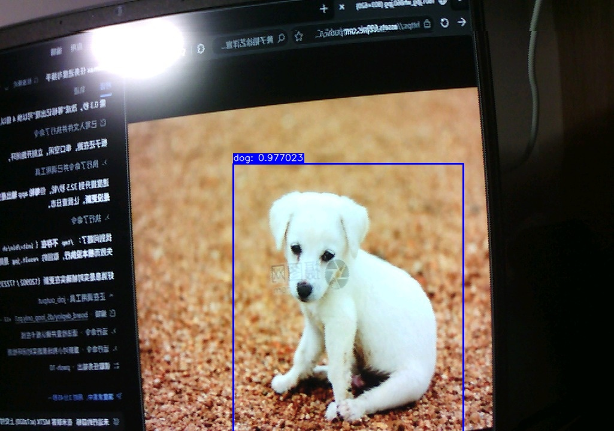
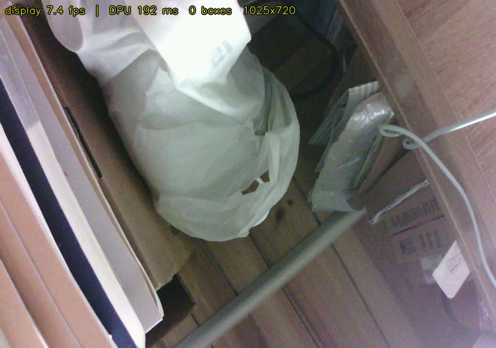

# Zynq-7020 + OV5640 + DPU 实时目标检测

在米兰科 **MZ7X**（Zynq-7020 / XC7Z020-2CLG400）上，把摄像头画面送进 PL 里的 **Xilinx DPU (B1152)**
跑 YOLOv3-tiny 推理，然后用 **HTTP M-JPEG** 在浏览器里看**实时带检测框的画面**。

实测成果：**1025×720 画面 7.5 fps**（正好跑满 OV5640 的输出帧率），检测框每秒更新约 4 次。



---

## 1. 它做到了什么

| 项 | 实测 |
|---|---|
| 画面分辨率 | 1025×720 RGB565（**真实行宽是 1025，不是 1280**，见 §7） |
| 画面帧率 | **7.5 fps**（= 摄像头输出帧率，画面无撕裂） |
| 检测框更新率 | 约 4 次/秒 |
| DPU 推理（预处理 + 推理） | 193 ms |
| DPU 计算结果 | 与历史 8/8 验收记录**逐字节一致**（`identical=1`） |
| 带宽 | 约 377 KB/s |
| 落盘 | **无** —— 画面全程在内存里，只经 socket 送出 |



---

## 2. 硬件与软件环境

| 项 | 版本 / 型号 |
|---|---|
| 板卡 | 米兰科 MZ7X，Zynq-7020 (XC7Z020-2CLG400-2) |
| 摄像头 | OV5640（DVP 并行接口，RGB565 输出） |
| 加速器 | Xilinx DPU `dpu_eu` v3.0，Arch **B1152**，Target v1.4.0，单核 |
| FPGA 工具 | Vivado 2019.1 |
| 交叉编译器 | `arm-linux-gnueabihf-gcc` **8.2.0**（随 Vivado SDK 提供，见 §6.2） |
| 目标 Linux | Yocto/PetaLinux 2019.1，内核 4.19.0-xilinx-v2019.1，**glibc 2.28** |
| 板端运行库 | `libn2cube.so` / `libdputils.so` / `libhineon.so`，OpenCV 3.4.3 |
| DNNDK | v3.1 |

---

## 3. 系统架构

```
OV5640 ──DVP──▶ cam_top ──AXIS──▶ frame_writer ──HP3──▶ DDR @ 0x08000000
                 (RGB565, 跨时钟域)   (滚动写, 无寄存器)      (1025×720×2 = 1,476,000 B)
                                                                  │
                                                        mmap /dev/mem
                                                                  ▼
                                              ┌──────────────────────────────────┐
                                              │   cam_stream   (板端常驻进程)      │
                                              │                                  │
                                              │  显示线程              推理线程     │
                                              │  ────────              ────────   │
                                              │  等帧边界              等帧边界     │
                                              │  memcpy → BGR          memcpy → BGR│
                                              │  画 g_boxes            letterbox   │
                                              │  JPEG 编码             量化(LUT)   │
                                              │  M-JPEG :8080          DPU 推理    │
                                              │                        YOLO 解码   │
                                              │                        NMS        │
                                              │       └── g_boxes ◀── 写结果       │
                                              │         （唯一共享点，一把小锁）     │
                                              └──────────────────────────────────┘
                                                                  │
                                                    HTTP M-JPEG   ▼
                                              浏览器 http://<board>:8080/
```

**两个线程各自独立抓帧**，只通过 `g_boxes` 交汇。这样 DPU 的 193 ms 只影响"框的更新率"，
不再拖累画面刷新 —— 见 §6 的帧率说明。

---

## 4. 目录结构

```
rtl/                         摄像头采集 RTL（自研部分）
  ov5640_cam_top.v             DVP 采集、跨时钟域、AXI-Stream 输出
  frame_writer.v               滚动写入 DDR 固定区域
  I2C_OV5640_1280720_Config.v  OV5640 上电寄存器配置表

vivado_projects/unified/       Vivado 工程（统一比特流：摄像头 + DPU 同一个比特流）
  unified.xpr
  unified.srcs/sources_1/bd/design_1/design_1.bd     Block Design 定义
  unified.srcs/sources_1/bd/design_1/ip/*/*.xci      各 IP 配置
  unified.srcs/constrs_1/                            时序与物理约束

board_deploy/                 板端程序、构建脚本、诊断工具、设计文档
  cam_stream.cpp              ★ 板端常驻推流程序（本项目核心交付）
  deephi_rel.o                ★ DPU 模型段（链接必需，见 §10）
  build_cam_stream.ps1        交叉编译（自动校验 7 个 .deephi 段）
  deploy_stream.ps1           原地部署到已在运行的板子
  bringup_and_stream.ps1      断电上电后一键：抢 U-Boot → 启动 → 起服务
  collect_sysroot.ps1         从板子收集交叉编译所需的头文件与库
  *.md                        设计文档与踩坑记录（见 §8）

docs/                         截图
design_1_regen.tcl            已知良好的 DPU Block Design 参数（对照参考）
system-user.dtsi              设备树补充：DPU 节点、xlnk、bootargs
```

---

## 5. 相关背景

原始的目录结构规划与 VMware 共享文件夹配置说明保留在
[`board_deploy/LEGACY_project_structure.md`](board_deploy/LEGACY_project_structure.md)，
以及 [`YOLOv3-on-Z-turn-V2-Tutorial.md`](YOLOv3-on-Z-turn-V2-Tutorial.md)（主教程）、
[`PROJECT_RETROSPECTIVE_AND_OV5640_PLAN.md`](PROJECT_RETROSPECTIVE_AND_OV5640_PLAN.md)（项目回顾与摄像头方案）。

---

## 6. 快速开始

### 6.1 板端运行

前提：板子已加载比特流、设好时钟、`insmod dpu.ko`。然后：

```bash
cd /home/root
wget -O cam_stream http://<pc-ip>:8000/cam_stream && chmod +x cam_stream
./cam_stream > /home/root/cam.log 2>&1 &
```

浏览器打开 `http://<board-ip>:8080/`。

**断电上电后的一键启动**（PC 侧执行，会自己抢 U-Boot 并完成全部准备）：

```powershell
powershell -ExecutionPolicy Bypass -File board_deploy\bringup_and_stream.ps1
```

先启动脚本，再给板子上电（脚本会持续轮询 U-Boot 提示符）。

### 6.2 从源码交叉编译

```powershell
# 1) 从板子收集 sysroot（只需一次；需要板子可 ping 通）
powershell -ExecutionPolicy Bypass -File board_deploy\collect_sysroot.ps1

# 2) 编译（约 5 秒，自动校验模型段数量）
powershell -ExecutionPolicy Bypass -File board_deploy\build_cam_stream.ps1
```

编译命令的关键点（都是踩过坑才定下来的）：

| 事项 | 值 | 为什么 |
|---|---|---|
| 编译器路径 | `…\SDK\2019.1\gnu\aarch32\nt\gcc-arm-linux-gnueabi\bin` | **不是** `Vivado\2019.1\gnu`（那里只有 MicroBlaze）；自带 glibc 2.28 与板子一致 |
| 模型 | 链接 `deephi_rel.o` | `dpuLoadKernel()` 从可执行文件里名为 `.deephi.*` 的 ELF 段读模型 |
| `elfedit` | 提取模型段后必须 `--output-type=rel` | objcopy 会保留 `ET_DYN`，链接器就把 `.o` 当共享库、**段会静默丢失** |
| 链接 OpenCV | 加 `-Wl,--allow-shlib-undefined` | OpenCV 的传递依赖（libtbb/libpng/libtiff/libwebp）在板子上，运行时才解析 |

### 6.3 HTTP 端点

| 路径 | 内容 |
|---|---|
| `/` | HTML 页面（全屏画面 + 帧率/推理耗时/框数/观看人数） |
| `/stream` | M-JPEG 流（`multipart/x-mixed-replace`） |
| `/latest` | 单帧 JPEG |
| `/stat` | JSON：`{"display_fps","display_frames","infer_ms","inferences","boxes","clients"}` |

---

## 7. 三个关键设计决定

### ① 帧同步：等帧边界，因此没有撕裂

`frame_writer` 是**连续滚动写** DDR 的，直觉上直接读必然混两帧。但读一帧只要约 5 ms，
而写一帧要 133 ms（7.5 fps），**读指针始终跑在写指针前面** —— 只要在帧刚开头时开始读，
整段读到的都是**上一帧的完整数据**（延迟一帧 = 133 ms，对预览毫无意义）。

实现：轮询 `0x41220000`（cam_top 暴露的 `line_cnt_r[11:4]`），等它回到 0..2 才开始 memcpy。
实测画面零撕裂。

### ② 预处理必须用 letterbox，不能拉伸

早期版本把画面直接拉伸到 416×416。而**已验证与历史 8/8 验收逐字节一致**的路径用的是
darknet 风格 letterbox（保持宽高比、灰边填充 0.5）+ 带 letterbox 偏移修正的框还原。
两者不等价，用拉伸会框偏。交付版采用 letterbox 路径（用 OpenCV 重写以获得 NEON 加速），
量化逻辑逐字复现：`int8_t(int(v/255*scale))`，负数再置 127；灰边 0.5 → 8bit 128 → 量化后 64。

### ③ 显示与推理解耦

画面流畅度和框的更新率是两件独立的事，但耦合在一起时总时间被 `DPU 125 ms + 编码 80 ms`
撑到 328 ms。解耦后显示路径只剩 `memcpy 5 + cvt 6.5 + 画框 3 + 编码 80 = 95 ms`，
低于摄像头帧周期 133 ms，于是画面跑满 7.5 fps。

> **帧率存在"台阶效应"**：因为每轮都要等下一个帧边界，总时间必然是帧周期的整数倍，
> `T_total = ceil(T_proc / T_cam) × T_cam`。所以优化不到跨过台阶就没有帧率收益 —— 实测数据
> 与这个公式吻合到 0.5 ms 以内。详见 `board_deploy/FPS_MECHANISM.md`。

---

## 8. 踩过的坑

### DPU 侧

| 现象 | 根因 | 修法 |
|---|---|---|
| `DPU configuration mismatch … Conv+Leakyrelu, DPU IP: Disabled` | BD 里 `dpu_eu_0` 的 `CONV_RELU_ADDON=2 / POOL_AVERAGE=0 / LOAD_AUGM=0`，导致 LeakyReLU、平均池化、通道增强三项缺失 | 改为 `3 / 1 / 1`（IP 的其余特性都由这几个主开关推导） |
| 特性对了，但推理出**非确定的垃圾**（`identical=0`） | **`dpu_2x_clk` 不是 `m_axi_dpu_aclk` 的整数 2 倍**（100/150）。IP 生成的约束用 `set_multicycle_path 2`，隐含这是 RTL 的功能假设而非单纯时序约束 | `CLKOUT3` 改 200 MHz，恢复精确 2 倍 |
| 改了 BD 参数，比特流却没变 | IP 被锁 → synth **静默沿用旧网表**（`the IP is locked … out-of-date checkpoint will be used`） | 必须先 `upgrade_ip` 清锁再 `generate_target`；且升级后要**重新校验** IP 参数（upgrade 可能重置它们） |
| DPU 寄存器能读，推理却全部超时 | `FCLK0` 是 200 MHz 而非 50 MHz，DPU 的 MMCM 从未锁定；而 S_AXI 由 FCLK0 直接驱动所以寄存器照样应答 | `0xF8000170 = 0x00201400`（IO_PLL 1000 MHz ÷ 20 = 精确 50.000 MHz） |

### 启动链

| 现象 | 根因 |
|---|---|
| `Starting kernel ...` 之后永久静默 | `image.ub` 加载到 `0x10000000` 时，FIT 内的设备树（偏移 `0x3F2BE4`）落到 **260 MB**，而 `mem=120M` 的内核够不着。必须加载到 `0x01000000` |
| 同上（另一条路径） | 不设 `fdt_high=0xffffffff`，U-Boot 会把 DTB 搬到 RAM 顶端（实测 `0x1fff9000` = 512 MB），同样超出 cap |
| 串口完全无响应 | **不要设 `DtrEnable`/`RtsEnable`** —— 置位后板子会停止响应命令，去掉立即恢复 |
| 每次改启动配置都必须物理断电 | 这块板 `reboot -f` 会停机（`System halted`） |

### 图像通路

| 现象 | 根因 |
|---|---|
| 画面分块/拼接错乱 | 按 1280 渲染，而**真实行宽是 1025**（用流自相关测出来的，峰值 +0.9914） |
| 红蓝互换 | 传感器在 `0x4300=0x60` 下输出 BGR565；改 `0x4300=0x61` |
| 画面出现分割/花屏 | 设备树里缺 `0x3820` / `0x3821`（参考工程里是有效的） |

### PowerShell / 工具链

| 现象 | 原因 |
|---|---|
| 脚本报一堆离谱语法错误、连行号都错位 | 脚本里写了非 ASCII 字符（`≈`、全角括号、中文冒号）。**PowerShell 脚本保持纯 ASCII** |
| `SerialPort.GetPortNames()` 不列出 COM10 | 注册表缓存问题，直接打开是可以的 |
| 板端 `/tmp` 不存在 | `init=/bin/sh` 只挂了 proc/sys/dev；重定向到 `/tmp/xxx` 会让整条命令被 shell 拒绝，**app 从未执行**，而轮询逻辑却把旧文件当新结果取回 |

---

## 9. 文档索引

`board_deploy/` 下的设计文档（按主题）：

| 文档 | 内容 |
|---|---|
| `RUNBOOK.md` | **运行手册** —— 重启流程、常用命令、故障排查 |
| `STREAM_DELIVERY.md` | 网页推流方案：架构、端点、三个关键设计决定 |
| `DECOUPLE_DESIGN.md` | 显示/推理解耦的设计推导与把握度评估 |
| `DECOUPLE_VERIFIED.md` | 解耦验收记录 |
| `FPS_MECHANISM.md` | 帧率"台阶效应"机制与实测验证 |
| `OPTIMIZATION_RISK.md` | 各优化方案的风险评估 |
| `DPU_ARCH_MISMATCH_FIX.md` | DPU 两个根因的完整证据链 |
| `FCLK0_ROOT_CAUSE.md` | `FCLK0 = 0x00201400` 的来历 |
| `D4_CLOSED_LOOP_VERIFIED.md` | 摄像头→DPU 闭环验收 |

---

## 10. 已知限制

| 项 | 现状 |
|---|---|
| 画面帧率上限 | **7.5 fps**，被 OV5640 输出帧率卡住（传感器实测只有 7.5 fps）。要提高需改摄像头寄存器表并重建比特流，且缩短曝光会影响画质与识别率 |
| 框的滞后 | 约 250 ms（DPU 193 ms + 解码）。快速移动的目标框会"飘" —— 这是 DPU 硬件的账，软件无法消除 |
| 开机自启 | 未做。断电后需运行 `bringup_and_stream.ps1` |
| 摄像头通路 | 存在一条 DRC 警告（跨时钟域 FIFO 的异步复位），目前画面干净，但若出现随机坏行优先查这里 |

---

## 11. 第三方代码与来源说明

本仓库中**并非全部代码都是原创**。为便于复现，以下文件保留了原作者版权头：

| 文件 | 来源 | 本项目所做的改动 |
|---|---|---|
| `rtl/I2C_OV5640_1280720_Config.v` | **CrazyBingo**（www.cnblogs.com/crazybingo）<br>Copyright 2012, All Rights Reserved | OV5640 上电寄存器配置表，摄像头能出图的关键依赖。末尾追加 `0x3820` / `0x3821`（消除上下分屏），修正 `0x4300=0x61`（R/B 顺序） |
| `rtl/i2c_timing_ctrl_reg16_dat8_wronly.v` | **CrazyBingo** | SCCB/I2C 时序控制器。SCL 降速至 33 kHz、SDA 改开路漏极、增加 sticky ACK 输出 |
| `rtl/asyn_fifo.v` | 第三方（见文件头） | 未改动 |

> ⚠️ **许可状态提示（如实披露）**：上表前两个文件的原始版权头声明为
> `CONFIDENTIAL IN CONFIDENCE` / *This confidential and proprietary software may be only used
> as authorized by a license agreement*。本项目**未从原作者处取得书面再分发授权**，保留它们
> 是为了让摄像头通路可复现。若需商业使用或再分发，请自行联系原作者取得许可，或自行实现
> 等价的 SCCB 主机与寄存器配置表。**这两个文件不适用本仓库的 MIT 协议**（见 `LICENSE`
> 末尾的 Third-party notice）。

**自研部分**（本项目的主要工作）：

- `rtl/ov5640_cam_top.v` —— DVP 采集、跨时钟域、AXI-Stream 输出、自愈式 SCCB 重试
- `rtl/frame_writer.v` —— 替代 AXI VDMA 的滚动写入器（VDMA 无法把本设计的 AXIS 当作帧接收）
- `board_deploy/cam_stream.cpp` —— 板端常驻推流程序
- 全部构建/诊断脚本与设计文档
- Vivado Block Design 中 `dpu_eu_0` 的配置修正（见 §8）

第三方 SDK（Xilinx DNNDK、DPU TRD）**未包含**在本仓库中，请从 Xilinx 官方渠道获取。

若你认为某个文件不应出现在这里，删除它不会影响其余部分的理解 —— 但摄像头通路需要自行补齐上述 I2C/寄存器文件。

---

## 12. 模型来源说明

`board_deploy/deephi_rel.o` 中的 DPU 模型段
（`.deephi.strtab/metadata/configurable/tensor/node/parameter/code.tiny_yolo`）
是从一个**可正常运行**的板端 app 中提取的：DNNDK 的 `dpuLoadKernel()` 会从当前可执行文件里
名为 `.deephi.*` 的 ELF 段读取模型，而板子上没有任何独立的 `.elf` 文件。

提取方式：

```bash
arm-linux-gnueabihf-objcopy -O elf32-littlearm --only-section='.deephi.*' <app> deephi.o
arm-linux-gnueabihf-elfedit --output-type=rel deephi.o     # 必须，否则链接时段会丢失
```

若你有用 `dnnc` 自行编译的模型 ELF，可以直接替换它参与链接。

---

## 13. 目录结构对照说明

本仓库保留了开发期自然形成的目录结构，未按推荐结构迁移。原因：Vivado 的 `.xpr` 以相对
路径硬引用 `vivado_projects/` 下的 2500+ 个文件，整体迁移的破坏风险高于收益。按赛题
"采用其他组织方式的队伍须在 README.md 中给出目录对照说明"的要求，对照表如下：

| 推荐目录 | 本仓库对应位置 | 内容 |
|---|---|---|
| `README.md` | `README.md` | 项目简介与复现步骤 |
| `src/` | `rtl/`、`board_deploy/cam_stream.cpp`、`system-user.dtsi` | PL 采集 RTL 与 PS 侧软件 |
| `sim/` | `rtl/cam_tb.v`、`rtl/cam_tb2.v`、`rtl/fw_tb.v`、`rtl/run_sim.bat` | 仿真测试台与运行脚本 |
| `build/` | `vivado_projects/unified/`、`board_deploy/build_cam_stream.ps1` | Vivado 工程、Block Design 与可复现构建脚本 |
| `board/` | `board_deploy/bringup_and_stream.ps1`、`deploy_stream.ps1`、`unified_clkfix_sw.bin` | 上板工程与运行脚本 |
| `data/` | `docs/`、`board_deploy/backup/` | 实测输出、基线版本与参考结果 |
| `skill/` | **待补** | 技能包（从开发过程中沉淀的可复用经验） |
| `report/` | `board_deploy/*.md`（见 §9 文档索引）；正式设计报告**待补** | 设计文档、踩坑记录与设计报告 |

> 所有目录名与文件名均为纯英文（小写字母、数字、下划线或连字符），符合跨平台复现要求。

---

## 14. 许可

本仓库**原创部分**采用 **MIT License**，见 [`LICENSE`](LICENSE)。

- 第三方 RTL 文件的权利仍属原作者，**不适用** MIT 协议，来源与改动情况详见 §11；
- Xilinx/AMD 专有材料（DNNDK、DPU TRD、Vivado 生成的 IP wrapper）**未包含**在本仓库中，
  请从 AMD 官方渠道获取。
